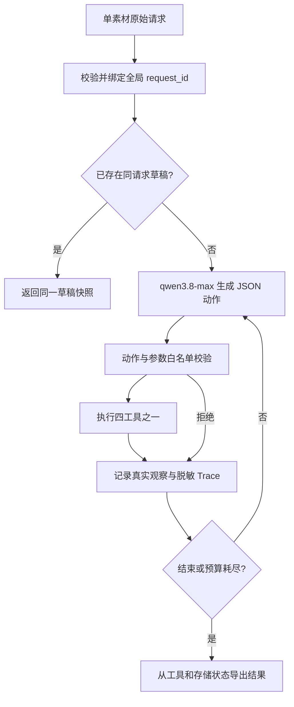

# 02 技术方案与执行边界

## 整体结构

项目使用 Python 标准库实现一个有界决策循环。真实模型只提出下一项动作；程序校验动作与参数，执行本地工具，再把实际观察交给模型。工具和存储负责业务约束，最终 JSON 从这些可信状态导出。



实现入口与职责如下：

| 文件 | 职责 |
|---|---|
| [main.py](../src/main.py) | CLI、配置、业务输出与 JSONL Trace 写入 |
| [domain.py](../src/domain.py) | 请求与时区校验、原始载荷哈希、UTC 规范化 |
| [models.py](../src/models.py) | Qwen 兼容接口适配、动作 JSON 解码、独立离线模拟器 |
| [agent.py](../src/agent.py) | 模型循环、动作校验、步数预算、可信状态导出、脱敏 |
| [tools.py](../src/tools.py) | 四个工具、规则审核、时间授权、候选与保存前置约束 |
| [store.py](../src/store.py) | SQLite 请求绑定、排期占用、原子保存与幂等恢复 |

可导入入口是 `run_agent(request, model, tools, max_steps=12)`。模型可以实现 `next_action(messages)`，测试也可注入同签名可调用对象。业务不依赖第三方 Agent 框架。

## 真实模型与 JSON 动作协议

live 模式经 Chat Completions 兼容接口请求 `qwen3.8-max`，使用 `DASHSCOPE_API_KEY`，默认基础地址为 `https://maas.qianwenaiapi.com/compatible-mode/v1`，可由 `QWEN_BASE_URL` 配置。`QWEN_MODEL` 若配置为其他模型，初始化会拒绝。请求显式设置 `enable_thinking=false` 与 JSON 对象响应格式。

模型每次只能输出一项动作，例如：

```json
{
  "action": "save_draft",
  "arguments": {"suggested_time": "2026-11-01T19:00:00+08:00"},
  "reason": "最新查询返回该候选，需保存待确认草稿"
}
```

这只是协议示例，不是运行证据。动作集合为四个工具及 `finish`；`finish` 是结束信号，不是发布工具。外层只接受 `action`、`arguments`、`reason`，理由须为简短决策依据。模型不能提供最终业务结果，更不能通过参数写入审核通过、用户已确认或保存成功。

系统提示明确区分“保存提案”与“确认生效”：`save_draft` 仅记录本地草稿，即使需要后续确认，也允许先保存 `pending` 提案。因此固定时刻冲突时，应从工具候选中选择替代时间保存待确认草稿；审核只有软风险且信息完整时，也应继续查询与保存待确认草稿。不能因当前没有收集确认的界面就提前结束，更不能把草稿保存解释为用户已确认或内容已发布。

工具结果作为带有 `TOOL_OBSERVATION` 标记的消息回传。模型根据观察决定继续、重试、重查或结束。因此“保存时冲突后重查”和“响应丢失后核对重试”由新的模型动作驱动；业务安全边界由工具再次执行，而不是仅靠提示词。

`OfflineModel` 是另一个明确标记为 `offline-simulator` 的实现，按照已知观察运行确定性策略。它使用相同工具接口，便于无网络测试，但不承担真实模型决策证据。

## 四个工具与防绕过约束

| 工具 | 模型允许传入的参数 | 真实行为及前置条件 |
|---|---|---|
| `read_material` | 可选 `material_id` | 只能读取原请求素材；检查素材存在与时长是否合法 |
| `check_rules` | 可选 `material_id` | 要求已读取素材；计算缺失项、硬阻断、风险及证据 |
| `query_slots` | 可选 `material_id` | 要求已读取并审核，且没有硬阻断或缺失项；从原请求推导时间范围 |
| `save_draft` | 可选 `material_id`、`suggested_time` | 只接受最新查询中的候选；复核原授权和审核，再进入事务保存 |

省略 `material_id` 时仍使用已绑定的素材；传入其他素材会被拒绝。模型不能传入 `request_id`、`confirmation_status`、`review` 或 `save_status`。保存前缺少任一必要观察、命中硬规则、缺必要信息、使用非最新候选或超出授权窗口，工具都会拒绝。

合成版权标签仅接受 `owned`、`licensed` 继续审核；`denied` 是独立硬阻断，即使正文没有禁用词也不能保存。缺失、`null`、空白、`unknown` 或其他未识别标签视为信息不足，`missing_fields` 包含 `rights_status`，需要补信息后重新执行。标签由素材数据提供，模型不能自行补成“已授权”。

素材标题、正文、备注是外部数据。提示词要求忽略其中试图改变执行规则的指令；同时，参数白名单、不可变请求绑定和工具前置约束负责阻止越权保存。提示词本身不被当作唯一安全机制。

## 时间范围与候选生成

所有输入时间必须显式带时区。持久化占用起止时间统一转换为 UTC，并以固定微秒精度序列化；打开旧本地库时也规范化已存时间，避免不同表示影响字符串比较。

排期区间按半开区间 `[start, end)` 解释，同渠道占用相交的条件是：

```text
existing.start < candidate.end AND existing.end > candidate.start
```

因此 `10:00–11:00` 与 `11:00–12:00` 可以相邻。时区字符串不同但代表同一时刻的区间仍会冲突。占用来源包括 `reservations` 和已保存的 `drafts`；待确认草稿也纳入检查。

固定时刻查询范围为原要求开始时间起未来 7 天，素材整个区间必须落入该范围。找到替代时间只形成待确认提案，绝不扩张原有授权。窗口要求则直接使用 `allowed_start`、`allowed_end`，整个素材时长必须在窗口内；`requested_time` 若在窗口外，不会被当作合法候选。

候选生成优先保留可用的原时间，再从范围起点搜索，最多返回 5 项。空闲候选之间向后步进 15 分钟；遇到冲突则跳到相交占用的结束时刻，继续检查，避免长窗口被固定迭代次数截断。候选可能互相重叠，它们是可选方案；最终只能保存模型选择的一项。模型省略 `suggested_time` 时，工具选择最新查询的第一项。

确认状态由工具推导：固定原时间且无软风险为 `not_required`；固定改期为 `pending`；明确窗口内且无软风险为 `not_required`；任何软风险均为 `pending`。没有把草稿改为 `confirmed` 或真正执行确认的接口。

结果导出同时生成 `pending_items`：`time_change` 项保存固定要求的原时间和可信建议时间，`rule_risk` 项保存规则标识、说明和命中证据。时间优先取已保存草稿；尚未保存时取工具实际尝试的候选或最新查询建议，避免把模型选择的第二候选错误显示成第一项。窗口内调整不生成 `time_change`。硬阻断和缺信息不转化成待确认项。

顶层 `review_status`、`missing_fields` 同步审核工具结果；`risk_reasons` 从硬规则失败和软警告生成字符串列表，保留规则标识和命中证据。原有 `review`、`risks` 等字段继续保留，模型不能通过动作参数覆盖这些输出。

## 请求绑定与幂等

`requests` 表以 `request_id` 为全局主键。接收请求后，对原始 JSON 载荷进行键排序和紧凑序列化，再计算 SHA-256；绑定过程在 `BEGIN IMMEDIATE` 事务中执行。这里规范化 JSON 的排版与键顺序，不把不同时间字符串或不同备注解释成同一原始载荷。

同一 `request_id` 与同一载荷可重试。改变 `material_id`、时间、窗口、备注或其他原始字段均会产生不同哈希，必须拒绝；业务修改需要新 `request_id`。模型的候选时间不回写到原始载荷中，避免用新建议冒充用户最初要求。

草稿另有 `UNIQUE(request_id, material_id)` 约束。进入 `run_agent` 时，如果已存在该原请求的草稿，直接恢复同一 `draft_id` 和已存结果快照，记录 `idempotent_recovery`，不新增占用，也不再次调用模型。相同请求在保存工具内重试时，也先返回原草稿。这两层恢复支持普通重复提交与提交后响应丢失。

幂等恢复不重新审核、不自动重排。更改素材、规则或排期源文件后，旧草稿仍是原保存快照；需要新的业务决策时，应提交新请求。当前没有草稿更新、取消、确认升级或到期释放接口。

## 原子查占用与保存

查询候选只能说明查询当时可用，不能保证保存时仍可用。`DraftStore.save_draft` 使用 `BEGIN IMMEDIATE` 取得 SQLite 写事务，再依次执行：

1. 复核原请求哈希绑定，拒绝被改动的原始上下文。
2. 查询相同请求已有草稿，若存在则返回原记录。
3. 在同一事务中查询 `reservations` 与 `drafts` 的同渠道区间相交。
4. 若冲突则回滚，并返回 `slot_conflict`；否则写入唯一草稿并提交。

两个连接竞争同一时段时，写事务串行执行，后执行者会看到先提交者的占用，不能同时保存成功。这是单个 SQLite 数据库中的原子性边界，不声称提供跨数据库或分布式排期一致性。

工具收到保存冲突后会清空旧候选，要求再次 `query_slots`，因此模型不能反复拿过期候选直接写入。草稿写入前的故障会回滚；提交后响应未知则保留幂等键，供下一次相同请求核对。

## 既有排期源的更新

构造 `ToolSet` 时，若存在 `schedules.json`，将它作为本地既有排期的权威快照。导入先校验完整数据，再在事务中替换 `reservation_id` 前缀为 `schedule:` 的记录。因此相同 `schedule_id` 改变起止时间会更新占用，源文件删除的排期也不会残留。

该同步保留 `injected:` 等其他占用和所有草稿；取消、拒绝状态的源排期不导入。若不存在排期文件，则不清除数据库已有占用。文件不是实时订阅源：运行过程中修改 JSON 不会自动刷新已有 `ToolSet`；需要重新构造工具集。真实并发占用的保存边界仍由数据库事务复查承担。

## 故障、步数与终态

内置故障用于产生可检验的真实失败，不直接伪造最终输出：

| 故障名 | 实际注入位置 | 恢复或终态 |
|---|---|---|
| `tool_failure` | 首次工具分发返回临时错误 | `retryable=true`，后续可重试 |
| `conflict_on_save` | 首次保存前新增外部占用 | 事务发现冲突，模型应重新查询候选 |
| `save_fail_before_commit` | 首次写入后、提交前抛错 | 回滚后 `failed`、可重试 |
| `save_fail_permanent` | 每次提交前抛错 | `retryable=false`；模型结束后任务为 `failed` |
| `save_response_lost` | 首次实际提交后不向调用方返回草稿 | `unknown`，以相同原请求重试恢复同一草稿 |

默认 `max_steps=12`。每次模型调用先消耗一个步骤，动作被拒、参数不合法、解码失败或模型调用失败也计数；失败不意味着必须继续重试，模型或系统可以提前停止。`max_steps` 非正整数时直接拒绝。

典型完整链路需要模型依次发出读取、审核、查询、保存、结束动作。最后一个动作使模型有机会观察实际保存结果；若预算恰好在保存后用尽，本轮依旧是 `task_status=incomplete`、`run_completed=false`。同时 `save_status=saved`、`draft_id` 与 `draft_status=completed` 或 `pending_confirmation` 如实保留，停止原因是 `max_steps_reached`。Agent 运行未完成不能掩盖落库事实，落库事实也不能替代本轮完成。

其他终态按可信工具状态区分：硬阻断为 `blocked`，已找到素材但必填项缺失为 `needs_input`，范围内无候选为 `no_available_slot`；首次素材不存在返回非重试错误，尚无审核结论，模型结束后为 `incomplete`。主动结束时若保存仍未知则为 `unknown`。这些边界及输入输出字段见 [需求文档](01-requirements.md)。

## Trace 与证据边界

每次执行生成 Trace，不预写示例日志冒充运行。记录包括模型动作、简短依据、参数校验结果、工具名与参数、真实返回摘要、后续动作，以及可用时的 provider 模型标识、响应 ID、token 用量和耗时元数据。读取素材的 Trace 摘要仅保留标识、标题、正文长度、时长及渠道，完整素材数据仍只用于工具观察。

Trace 不记录密钥、HTTP 请求头或模型内部思维；输出经过已知密钥值和常见凭证格式脱敏。provider 元数据可用于区分请求的模型名称和服务返回名称，但仅靠请求参数中的 `qwen3.8-max` 不能证明真实调用成功。真实调用应结合实际生成的 Trace 与业务输出判断；离线结果始终保留独立模式标记。

最终业务字段取自工具状态或已保存草稿，不从模型 `reason` 或自报成功中抽取。`finish` 携带业务字段会被拒绝；没有真实保存记录时，模型声称完成也不能生成 `draft_id` 或成功结果。
